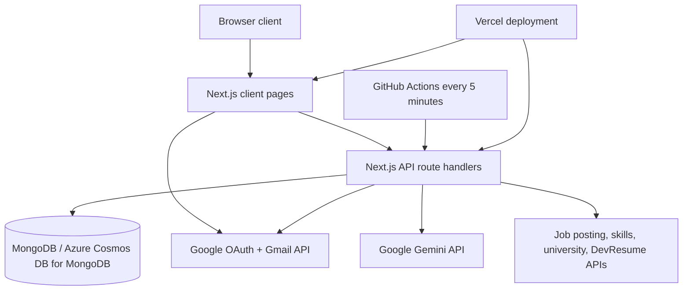
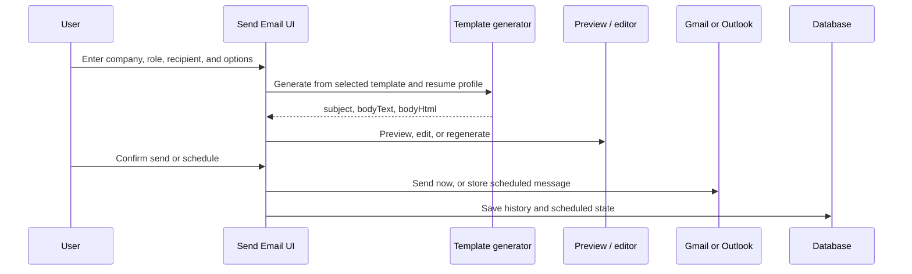

# Architecture

## System summary

JobMail is a Next.js 14 App Router application. The browser renders the authenticated app shell and client-side workflows; Next.js route handlers provide persistence and integrations; Vercel hosts the web application; MongoDB-compatible storage holds user data.

## Main layers

### UI and navigation

- `app/page.tsx` and `AuthGate` select the signed-out landing page or signed-in application shell.
- `app/pages/` contains the main feature pages: Send Email, Resume Builder, Email Templates, History, Scheduled, Profile, Cover Letter, and supporting pages.
- `components/` contains reusable UI, sidebar, authentication, upload, dialog, and form primitives.
- `app/providers.tsx` owns Google auth, app auth context, theme state, and toast notifications.

### Domain and integration logic

- `lib/emailTemplateGenerator.ts` produces plain-text and HTML email variants for the template catalog.
- `lib/templateSkillsService.ts` stores per-user, per-profile, per-template skill overrides in browser local storage. The main resume profile remains independent.
- `lib/resumeDataService.ts` and `lib/scheduledEmailService.ts` wrap API calls for their domains.
- `lib/googleAuth.ts`, `lib/sendGmail.ts`, and `lib/gmailClient.ts` handle OAuth/token refresh and Gmail message construction.
- `lib/resumeAiParser.ts` and `lib/coverLetterAi.ts` call Gemini only on server-side API paths.

### Server routes

Route handlers under `app/api/` validate request shapes, call external services, and read/write MongoDB collections. See [API.md](./API.md) for the route contract.

## Email generation flow

## Resume and skill isolation

Resume profile fields and the main selected skill list are persisted through `/api/resume`. Template-specific skills are intentionally stored separately in local storage under a user/profile key. Selecting, adding, removing, or resetting skills for one template does not mutate the `Your Information` profile or another template. If a template has no override, the generator falls back to the profile's selected skills.

## Background scheduling

1. The user creates a pending record through `/api/scheduled-emails`.
2. GitHub Actions runs `.github/workflows/scheduled-email-cron.yml` every five minutes.
3. The workflow calls `/api/cron/process-scheduled-emails` with `CRON_SECRET`.
4. The route obtains a valid access token from the encrypted refresh token, sends due messages through Gmail, and updates scheduled/history records.

GitHub schedule timing is best-effort and may be delayed during platform load.
